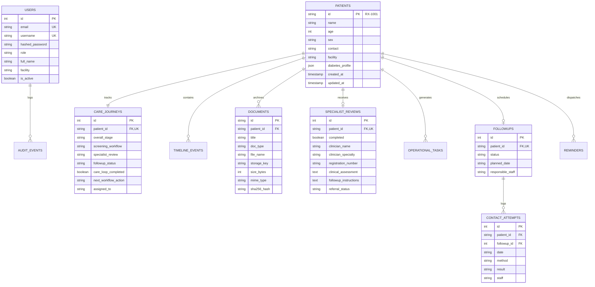

# RetinaX Care — Database Schema & Data Model Reference

**ORM:** SQLAlchemy 2.0  
**Migration Engine:** Alembic  
**Target Engine:** PostgreSQL 16 (SQLite fallback for local test execution)  

---

## 1. Entity-Relationship Diagram

---

## 2. Table Definitions & Constraints

### 2.1 `users`
- `id` (Integer, Primary Key, Auto-increment)
- `email` (VARCHAR(255), Unique, Not Null, Indexed)
- `username` (VARCHAR(64), Unique, Not Null, Indexed)
- `hashed_password` (VARCHAR(255), Not Null) — Argon2id hash format `$argon2id$v=19$m=65536,t=3,p=4$...`
- `role` (VARCHAR(64), Not Null) — `Specialist`, `Care Coordinator`, `Administrator`
- `full_name` (VARCHAR(128), Not Null)
- `facility` (VARCHAR(128))
- `registration_number` (VARCHAR(64)) — Medical council registration for specialists
- `is_active` (Boolean, Default True)
- `created_at` (TIMESTAMP WITH TIME ZONE)

### 2.2 `patients`
- `id` (VARCHAR(32), Primary Key) — Synthetic identifier format: `RX-1001`
- `name` (VARCHAR(128), Not Null, Indexed)
- `age` (Integer, Not Null)
- `sex` (VARCHAR(16), Not Null)
- `contact` (VARCHAR(32)) — Synthetic telephone number
- `facility` (VARCHAR(128)) — Primary Health Centre or outreach clinic
- `clinician` (VARCHAR(128)) — In-take staff
- `registration_date` (VARCHAR(32))
- `diabetes_profile` (JSON/JSONB) — Operational profile:
  - `type`: Type 2 Diabetes Mellitus
  - `duration_recorded`: Documentation status
  - `last_hba1c`: Laboratory documentation (used strictly for schedule adherence)
  - `current_medications`: Medication list on file
- `created_at` (TIMESTAMP WITH TIME ZONE)
- `updated_at` (TIMESTAMP WITH TIME ZONE)

### 2.3 `care_journeys`
- `id` (Integer, Primary Key)
- `patient_id` (VARCHAR(32), Foreign Key `patients.id` ON DELETE CASCADE, Unique, Indexed)
- `overall_stage` (VARCHAR(64))
- `screening_workflow` (VARCHAR(64)) — `Not Started`, `Scheduled`, `Completed`
- `screening_appointment_date` (VARCHAR(32), Nullable)
- `document_status` (VARCHAR(64))
- `specialist_review` (VARCHAR(64)) — `Not Started`, `Pending Review`, `Completed`
- `followup_status` (VARCHAR(64)) — `Pending`, `Scheduled`, `Completed`, `Unable to Contact`
- `care_loop_completed` (Boolean, Default False)
- `next_workflow_action` (VARCHAR(255))
- `assigned_to` (VARCHAR(128))
- `due_date` (VARCHAR(32), Nullable)

### 2.4 `specialist_reviews`
- `id` (Integer, Primary Key)
- `patient_id` (VARCHAR(32), Foreign Key `patients.id` ON DELETE CASCADE, Unique, Indexed)
- `completed` (Boolean, Default False)
- `clinician_name` (VARCHAR(128), Nullable) — Attributed specialist name
- `clinician_specialty` (VARCHAR(128), Default `Ophthalmology`)
- `registration_number` (VARCHAR(64))
- `review_timestamp` (VARCHAR(32))
- `clinical_assessment` (TEXT) — Qualitative clinical findings
- `followup_instructions` (TEXT) — Care directives for the coordination desk
- `referral_status` (VARCHAR(128)) — e.g. `Hospital Follow-Up (6 Months)`, `Routine Annual`

### 2.5 `documents`
- `id` (VARCHAR(64), Primary Key)
- `patient_id` (VARCHAR(32), Foreign Key `patients.id` ON DELETE CASCADE, Indexed)
- `title` (VARCHAR(255), Not Null)
- `doc_type` (VARCHAR(128), Not Null) — `Retinal Screening Report`, `Referral Letter`, etc.
- `upload_date` (VARCHAR(32), Not Null)
- `file_name` (VARCHAR(255), Not Null)
- `storage_key` (VARCHAR(255), Not Null) — Sanitized UUID-prefixed object key
- `size_bytes` (Integer, Default 0)
- `mime_type` (VARCHAR(64), Default `application/pdf`)
- `sha256_hash` (VARCHAR(64), Not Null)

### 2.6 `followups` & `contact_attempts`
- `followups`: Tracks macro status, planned review visit date, staff owner.
- `contact_attempts`: Relational 1:N table capturing chronological interaction attempts:
  - `method`: Phone Call, SMS, WhatsApp, Home Visit (ASHA), In-Clinic Counseling
  - `result`: Outcome summary
  - `staff`: Coordinator or outreach worker responsible.

### 2.7 `audit_events`
- `id` (Integer, Primary Key)
- `user_id` (VARCHAR(64), Nullable)
- `user_name` (VARCHAR(128), Not Null)
- `user_role` (VARCHAR(64), Not Null)
- `action` (VARCHAR(128), Not Null, Indexed) — e.g. `SPECIALIST_REVIEW_COMPLETED`
- `resource_type` (VARCHAR(64))
- `resource_id` (VARCHAR(64))
- `details` (JSON)
- `ip_address` (VARCHAR(64))
- `timestamp` (TIMESTAMP WITH TIME ZONE, Default `now()`, Indexed)
